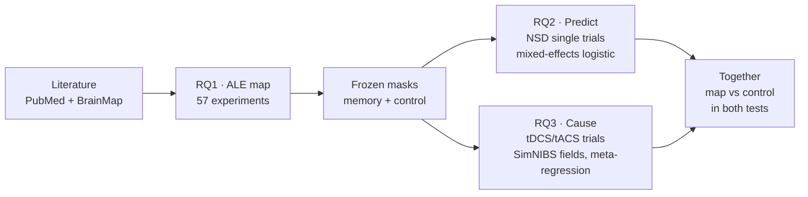

# From Convergence to Consequence

**Does the brain's episodic-retrieval network predict and causally support memory?**

*Tanisha Handoo, B.Sc. Neurosciences & Neuropsychology, Amity University.*

[Project page with interactive charts](https://tanishahandoo2002-afk.github.io/convergence-to-consequence/) ·
[Results write-up](docs/report.md) · [Protocol](docs/registration-1-rq1.md) · [Changelog](CHANGELOG.md)

<picture>
  <source media="(prefers-color-scheme: dark)" srcset="https://tanishahandoo2002-afk.github.io/convergence-to-consequence/glass_dark.png">
  
</picture>

## Why this project

Meta-analyses of fMRI studies place a "recollection network" in the hippocampus, posterior parietal cortex and
medial prefrontal cortex. These maps are used as regions of interest and, more and more, as targets for brain
stimulation meant to help memory in ageing and dementia. They are rarely tested. Convergence across
group-averaged studies does not show that activity there predicts memory for single events, or that changing
activity there changes memory.

This project builds a curated map of the network and tests it twice. Both tests compare it with a
domain-general control network: regions that are active in almost any demanding task.

| | Question | Data | Answer |
| --- | --- | --- | --- |
| **RQ1 · Map** | Where does activity converge when people successfully remember? | 57 fMRI/PET experiments, 826 peak coordinates (PubMed + BrainMap) | 8 clusters: posterior cingulate, angular gyrus, precuneus, left hippocampus, medial prefrontal cortex and others |
| **RQ2 · Predict** | Does activity in the map track memory for single images? | Natural Scenes Dataset: 8 people, 284 sessions of 7T fMRI, 213,000 trials | **Yes.** Map signal predicts remembered vs forgotten images and separates true from false "old" responses better than the control network |
| **RQ3 · Cause** | Do tDCS/tACS memory effects depend on how much field reaches the map? | 92 effects from 45 sham-controlled trials, each montage modelled in SimNIBS | **No evidence.** Field in the map does not explain which trials improved memory; the intervals are wide |

## How it fits together

The map was built and its masks were frozen with SHA-256 hashes before any fMRI or stimulation trial was
opened, so neither test could shape the map it tests.



<picture>
  <source media="(prefers-color-scheme: dark)" srcset="https://tanishahandoo2002-afk.github.io/convergence-to-consequence/masks_dark.png">
  
</picture>

*The two frozen masks. Blue: the memory map from RQ1. Orange: the control network, made of the
multiple-demand parcels (Fedorenko et al., 2013) minus any memory-map voxel.*

## Results at a glance

<picture>
  <source media="(prefers-color-scheme: dark)" srcset="https://tanishahandoo2002-afk.github.io/convergence-to-consequence/results_dark.png">
  
</picture>

- **H2a.** Map signal predicts a hit rather than a miss: 0.641 log-odds per SD (95% CI 0.210 to 1.072). It holds
  when each participant is left out in turn and on the b2 betas (0.617).
- **H2b.** On trials answered "old", the map separates hits from false alarms more than the control network
  does. The difference is 0.447 (0.294 to 0.601); the control signal is, if anything, higher on false alarms.
- **H2c.** The map's link to memory weakens as the delay since the last view grows. The interaction is -0.228
  on b3 and -0.122 on b2, the same direction at about half the size.
- **H3a and H3b.** Field strength in the map does not predict the effect size: 0.31 g per V/m (-2.90 to 3.52),
  and map minus control field is 0.45 (-14.7 to 15.6). The pooled stimulation effect is g = 0.211
  (0.112 to 0.310), but small-study tests put the adjusted effect close to zero.

The map does better than the control network at predicting memory, but not detectably as a stimulation
target. The full numbers, robustness checks and limitations are in the [write-up](docs/report.md) and on
the [project page](https://tanishahandoo2002-afk.github.io/convergence-to-consequence/).

## Read with care

- Title/abstract screening, full-text proposals and contrast choices came from AI raters and an AI assistant.
  The author accepted the suggestions as one decision, and there was no second human rater. See
  [Use of AI tools](#use-of-ai-tools).
- 17 of the 57 RQ1 experiments could not be checked against their papers. Three of the eight clusters,
  including the hippocampus, depend on them, so a verified-only map is reported alongside the main one.
- One young head model (and one older head as a check) stands in for every stimulation participant.

## Repository

| Folder | What is in it |
| --- | --- |
| `rq1_map/` | Search, screening, extraction sheets, `run_ale.py` (NiMARE) |
| `masks/` | `build_masks.py`, the frozen masks and their hashes in `FROZEN.sha256` |
| `rq2_nsd/` | Native-space masks, single-trial extraction from NSD, `models.R` (lme4) |
| `rq3_stimulation/` | Screening, effect sizes, RoB 2, SimNIBS montages and fields, `models.R` (metafor) |
| `integration.R` | The map vs control comparison from RQ2 and RQ3, side by side |
| `checks/`, `tests/` | A check script for every stage, and known-answer tests on synthetic data |
| `webpage/` | Builds the project page and the README figures from the result files |
| `docs/` | Design, protocol, plans and the results write-up |

Result files are written to `rq2_nsd/results/`, `rq3_stimulation/results/` and `results/` and are not
committed to `main`. The project page and the figures above are on the `gh-pages` branch.
Every deviation from the protocol is dated in [`CHANGELOG.md`](CHANGELOG.md).

## How to run

```bash
export C2C_DATA=/Volumes/<drive>/c2c_data      # large and non-shareable data
export NCBI_EMAIL=<contact email for NCBI E-utilities>
export ASI_API_KEY=<key>                        # AI screening rater 1 (asi1-mini)
OLLAMA_MODELS=$C2C_DATA/ollama ollama serve     # AI screening rater 2 (qwen2.5:7b-instruct)
make setup    # environment + setup check (Python venv via uv, R packages via renv::restore())
make test     # known-answer tests on synthetic data (Python and R)
```

| Stage | Command | Needs |
| --- | --- | --- |
| RQ1 search, screening, ALE | `make rq1-search`, `make rq1-screen`, `make rq1-check-screen`, `make rq1` | PubMed, ASI key, Ollama |
| Masks (frozen) | `make masks` | RQ1 results |
| RQ2 native masks | `python -m rq2_nsd.to_native`, then `python -m checks.check_rq2 --native` | NSD access, frozen masks, overlay sign-offs |
| RQ2 blind pilot, extraction, models | `make rq2-pilot`, `make rq2` | native masks |
| RQ2 b2 robustness (extraction, models, comparison with b3) | `make rq2-b2` | RQ2 b3 results |
| RQ3 search, screening | `make rq3-search`, `make rq3-screen`, `make rq3-check-screen` | PubMed, ASI key, Ollama |
| RQ3 electric fields | `make rq3-fields` | SimNIBS 4.6 |
| RQ3 effect sizes, models | `make rq3-es`, `make rq3` | extraction sheets, field values |
| Integration (H2b next to H3b) | `make integration` | RQ2 and RQ3 results |
| Project page and README figures | `make page` → `webpage/build/` | every stage's results |

A full extraction streams every NSD session once and takes many hours; re-runs skip sessions already
listed in the manifest. Requires Python 3.12 and R 4.5. Every stage target runs its check script afterwards
and stops if the check fails. `make all` from a fresh clone rebuilt the masks voxel for voxel and reproduced
the RQ2, RQ3 and integration results byte for byte. Design: [`docs/design.md`](docs/design.md).

## Data access

| Data | Access |
| --- | --- |
| BrainMap (Sleuth) | Account via the BrainMap database application form |
| Natural Scenes Dataset | NSD Data Access Agreement; raw NSD files are never redistributed |
| OASIS-2 | Open access under the OASIS data use terms; one T1 scan is used, kept outside the repo |
| PubMed | Open |

## Citation and acknowledgements

To cite this project: Handoo, T. (2026). *From Convergence to Consequence: does the brain's episodic-retrieval
network predict and causally support memory?*
https://github.com/tanishahandoo2002-afk/convergence-to-consequence

RQ2 uses the Natural Scenes Dataset: Allen, St-Yves, Wu, Breedlove, Prince, Dowdle, Nau, Caron,
Pestilli, Charest, Hutchinson, Naselaris and Kay, "A massive 7T fMRI dataset to bridge cognitive
neuroscience and artificial intelligence", *Nature Neuroscience* 25, 116-126 (2021),
doi:[10.1038/s41593-021-00962-x](https://doi.org/10.1038/s41593-021-00962-x).
Collection of the NSD dataset was supported by NSF IIS-1822683 and NSF IIS-1822929.
No NSD file, trial table or image is in this repository.

Data were provided in part by OASIS. OASIS-2: Longitudinal: Principal Investigators: D. Marcus, R. Buckner,
J. Csernansky, J. Morris; P50 AG05681, P01 AG03991, P01 AG026276, R01 AG021910, P20 MH071616, U24 RR021382.
Marcus et al. (2010), *Journal of Cognitive Neuroscience* 22, 2677-2684,
doi:[10.1162/jocn.2009.21407](https://doi.org/10.1162/jocn.2009.21407).

BrainMap: Fox & Lancaster (2002), doi:[10.1038/nrn789](https://doi.org/10.1038/nrn789); Fox et al. (2005),
doi:[10.1002/hbm.20141](https://doi.org/10.1002/hbm.20141). SimNIBS: Thielscher, Antunes & Saturnino (2015),
doi:[10.1109/EMBC.2015.7318340](https://doi.org/10.1109/EMBC.2015.7318340). The full reference list, covering
the methods and software, is at the end of the
[project page](https://tanishahandoo2002-afk.github.io/convergence-to-consequence/#references).

## Use of AI tools

Title/abstract screening used two independent large language model raters, plus a third AI
suggestion on each record routed to the author. The author accepted every suggestion as one
decision, so these decisions equal the AI suggestions (`CHANGELOG.md`, 2026-11-07).
No second human rater took part, so no human reliability measure is reported for screening.
Extracted contrasts were chosen by an AI assistant, and the author accepted its suggestions as one
decision, without a recorded paper-by-paper check. 17 BrainMap experiments stay in unverified,
because their papers could not be accessed, and a verified-only map is produced alongside the main one.
An AI assistant also helped draft code; the author ran, read and checked every script.
At the team's request, an AI assistant drafted `docs/report.md`, the project page and this README from the
scripts' outputs.
Coordinates came from BrainMap exports or were read by a script from PMC tables, from those same
AI-chosen rows (`CHANGELOG.md`, 2026-11-07). No person or model typed them.
